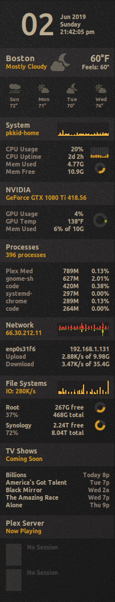

# Conky-PKMeter



A Conky configuration written entirely in Lua. It includes clock, weather,
system, GPU, process, network, filesystem, media, Bambu printer, AI usage
(Claude, Codex, and OpenRouter credits), and to do list widgets.

## Installation

```bash
sudo apt install conky-all lua-socket lua-sec playerctl curl unzip
git clone https://github.com/pkkid/conky-pkmeter.git
cd conky-pkmeter
conky -c conkyrc
```

## Configuration

Widget settings and the default display order are defined in `config.lua`.
Window placement, size, and Conky behavior are configured in `conkyrc`.
Display choices such as units, icon theme, and sort order are set from the
right click menu instead (see [Right Click Menu](#right-click-menu)).
Long titles, including accented characters and emoji, are shortened to fit.

- `system`: Set `coretempstr` to the CPU temperature sensor. Sensors such as
  `hwmon coretemp temp 1` can use the driver name from
  `/sys/class/hwmon/*/name` instead of a number, since the numbers can change
  between boots. The memory ring shows used memory solid and cache the kernel
  can free on demand faded.
- `openmeteo`: Set your location, timezone, and wind speed unit.
- `networks`: Find interface names with `ip link`, then configure the devices to monitor.
- `filesystems`: Find mount paths with `df -h`, then configure the paths to monitor.
- `nowplaying`: Uses `playerctl` for playback information and controls.
- `bambu`: Set the printer host, serial number, and LAN access code.
- `todolist`: Shows checklist items (`- [ ]`, `- [x]`) from `todolist.md` beside
  `conkyrc`, or the path set in `file`. Checked items are dimmed and listed last;
  other content is ignored. The widget hides when there are no items. Click the
  header to open the file, or click an item to check or uncheck it in the file.

## AI Usage

The `aiusage` widget shows Claude, Codex, and Gemini limits in one table, with a row
per service: the left meter is the five-hour limit left and the right meter the
weekly (or longer) limit left. A dot under each meter marks how much of that
window's time is left; a meter that reaches past its dot is under pace. Limits
under 15% remaining turn `color_low`. Hover over or click a value to see the
exact day and time that limit resets; the next click only closes it. Enable or disable each service with `enabled` in
`config.aiusage.claude`, `config.aiusage.codex`, `config.aiusage.gemini`, or
`config.aiusage.openrouter`,
or show and hide each provider from *Providers* in the right click menu.

Each provider has its own gruvbox `color`, used for its limit bars and its line in
the header graph. The header shows the time since the oldest update and a
smooth line per provider of tokens used each day over the last seven days (set
`history_days` to change it), on a shared log scale so smaller providers still
show their shape (toggle *Log scale graph* in the right click menu); hover over
it for totals. Every 15 minutes a background Lua process reads only the
new lines of the local Claude Code and Codex transcripts, plus any changed
Antigravity conversation databases from `agy` and T3 Code (read with the
`sqlite3` command), and saves hourly totals to `/tmp/pkmeter-tokens.json`, so it
covers all local use, not just time pkmeter was running. Use *Refresh now* in
the right click menu to update every service immediately.

The model mix and weekly pacing are hidden by default; click the widget content
or use *Show details* in the right click menu to toggle them. The model mix lists each
service's top three local models by token share and prompt count, allocated
against that service's own limit, so the combined list totals up to 200%. It
excludes activity from other machines.
Model mixes refresh every 15 minutes in a background Lua process.

### OpenRouter

Shows the remaining OpenRouter credit balance at the bottom of the widget;
hover over it to see credits used and purchased. Every 15 minutes a
background Lua process reads `OPENROUTER_API_KEY` from `key_file` (`KEY=value`
lines) or the environment and saves the balance to
`/tmp/pkmeter-openrouter.json`. If the key can't be read, the last balance
stays and the poll retries with capped backoff. Requires LuaSec (`ssl.https`).

### Codex

Every 15 minutes, starts the locally installed Codex App Server and reads the
account's limit snapshot into `/tmp/pkmeter-codex.json`. The App Server renews
its own login, so Codex only needs to be signed in once. Codex must be on
`PATH`; API-key-only and Bedrock authentication do not provide usage data.
A free plan's single 30 day limit shows in the *Week* column.
Failed reads keep the last snapshot and retry with capped backoff. Requires
`timeout` from GNU coreutils. The model mix reads local Codex session records.

### Gemini

Gemini limits are a workaround until the Antigravity CLI (`agy`) can report
usage. Every 15 minutes a background Lua process reads the Google login T3
Code saved when you signed into Antigravity
(`~/.t3/userdata/providers/antigravity/*/antigravity-acp/acp_token.json`, or
`token_file`), trades it for a short-lived access token, and asks Google's
quota service for the summary, the same way T3 Code does. The token is only
sent to Google and is never logged or saved elsewhere. Results go to
`/tmp/pkmeter-gemini.json`. Hover over or click the weekly value to see the
Gemini Argon and shared Claude and GPT pools. Requires LuaSec (`ssl.https`).
Set `enabled = false` to turn it off.

### Claude

Every 15 minutes, runs the locally installed Claude CLI with a `get_usage`
control request (no prompt is sent, so it uses no tokens) and saves the
five-hour, weekly, and per-model weekly limits to `/tmp/pkmeter-claude.json`.
This is the same request T3 Code uses, so it works however you run Claude Code.
`claude` must be on `PATH` and signed in to a Pro or Max plan. Hover over or
click the weekly value to see per-model limits such as Fable. The model mix
reads local transcripts in `~/.claude/projects`.

## Auto Start

Add the following command to Ubuntu Startup Applications:

```bash
/usr/bin/bash -c "/usr/bin/sleep 5; cd ~/Projects/conky-pkmeter/ && conky -c conkyrc"
```

## Mouse Clicks

[Conky issue #2047](https://github.com/brndnmtthws/conky/issues/2047) can cause
mouse clicks to be reported as `mouse_enter` under XWayland and some X11 window
managers. As a temporary workaround, handle `mouse_enter` instead of
`button_down` in `pkmeter.lua` and use:

```lua
own_window_type = 'normal',
own_window_hints = 'skip_taskbar,sticky,below',
```

This workaround may display a window title on the panel.

## Right Click Menu

Right click a widget to open a menu drawn inside the Conky window. Empty space
below the widgets passes right clicks to the desktop, unless every widget is
hidden. Click outside the menu or wait ten seconds to close it. Set its colors
with `menu_bg`, `menu_border`, and `menu_hover` (the row under the pointer) in
`config.lua`.

The top of the menu holds the clicked widget's options, such as refreshing,
°F or °C, log scale graphs, the weather icon theme, the process sort, 12 or 24
hour time, or opening a related app. *Copy external IP* needs `wl-copy` or
`xclip`. Every widget can also be moved up, moved down, or hidden. The bottom
holds *Widgets* to turn each widget on or off, plus edit config, reload, and
quit.

Choices are saved to `toggles.json` beside `conkyrc` and kept across restarts.
The widget order in `config.lua` is used until you move or hide a widget, after
which the saved layout is shown; *Widgets › Reset layout* returns to the config
order. Widgets added to `config.widgets` later appear at the end.

## Credits

Fisadev and Zineddine SAIBI created the original Conky drawing scripts.
