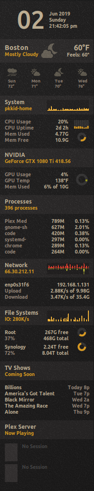

# Conky-PKMeter



A Conky configuration written entirely in Lua. It includes clock, weather,
system, GPU, process, network, filesystem, media, Bambu printer, AI usage
(Claude and Codex), and to do list widgets.

## Installation

```bash
sudo apt install conky-all lua-socket lua-sec playerctl curl unzip
git clone https://github.com/pkkid/conky-pkmeter.git
cd conky-pkmeter
conky -c conkyrc
```

## Configuration

Widget settings and the default display order are defined in `config.lua`.
Window placement, size, and Conky behavior are configured in `conkyrc`.
Display choices such as units, icon theme, and sort order are set from the
right click menu instead (see [Right Click Menu](#right-click-menu)).
Long titles, including accented characters and emoji, are shortened to fit.

- `openmeteo`: Set your location, timezone, and wind speed unit.
- `networks`: Find interface names with `ip link`, then configure the devices to monitor.
- `filesystems`: Find mount paths with `df -h`, then configure the paths to monitor.
- `nowplaying`: Uses `playerctl` for playback information and controls.
- `bambu`: Set the printer host, serial number, and LAN access code.
- `todolist`: Shows checklist items (`- [ ]`, `- [x]`) from `todolist.md` beside
  `conkyrc`, or the path set in `file`. Checked items are dimmed and listed last;
  other content is ignored. The widget hides when there are no items. Click the
  header to open the file, or click an item to check or uncheck it in the file.

## AI Usage

The `aiusage` widget combines Claude and Codex usage in one panel. Enable or
disable either service with `enabled` in `config.aiusage.claude` or
`config.aiusage.codex`. Each service shows its five-hour and weekly usage
(e.g. `Claude 5h`, `Codex Week`) with local reset times: `1:13p` for five-hour
windows and `Sat 4:32p` for weekly windows.

The header shows the plans, time since the oldest limit update, and a status
dot per service: blue while running, orange while waiting for you. With both
active the dots sit side by side; clicking the header refreshes both services.

The model mix and weekly pacing are hidden by default; click the widget content
or use *Show details* in the right click menu to toggle them. The model mix lists each
service's top three local models by token share and prompt count, allocated
against that service's own limit, so the combined list totals up to 200%. It
excludes activity from other machines.
Model mixes refresh every five minutes in a background Lua process.

### Codex

Every 15 minutes, starts the locally installed Codex App Server and reads the
account's limit snapshot into `/tmp/pkmeter-codex.json`. The App Server renews
its own login, so Codex only needs to be signed in once. Codex must be on
`PATH`; API-key-only and Bedrock authentication do not provide usage data.
Failed reads keep the last snapshot and retry with capped backoff. Requires
`timeout` from GNU coreutils. Task status and the model mix read local Codex
session records.

### Claude

Claude has no usage API that works without a login, so Claude Code reports
its own usage. After each reply it passes its status JSON, including the
five-hour and weekly percentages, to its status line command. Have that command
save the JSON to `~/.claude/statusline.json` by adding this to
`~/.claude/settings.json`:

```json
"statusLine": {
  "type": "command",
  "command": "umask 077; cat > ~/.claude/statusline.json.$$ && mv ~/.claude/statusline.json.$$ ~/.claude/statusline.json"
}
```

pkmeter reads the file, and other programs can read it too. Values update
whenever you use Claude Code (Pro or Max plans only); a window shows 0% once
its reset time passes. The command prints nothing, so a terminal session's
status line stays blank. Set the header's plan name with `plan`. Task status
reads the undocumented `~/.claude/sessions` files, which may change between
releases. The model mix reads local transcripts in `~/.claude/projects`.

## Auto Start

Add the following command to Ubuntu Startup Applications:

```bash
/usr/bin/bash -c "/usr/bin/sleep 5; cd ~/Projects/conky-pkmeter/ && conky -c conkyrc"
```

## Mouse Clicks

[Conky issue #2047](https://github.com/brndnmtthws/conky/issues/2047) can cause
mouse clicks to be reported as `mouse_enter` under XWayland and some X11 window
managers. As a temporary workaround, handle `mouse_enter` instead of
`button_down` in `pkmeter.lua` and use:

```lua
own_window_type = 'normal',
own_window_hints = 'skip_taskbar,sticky,below',
```

This workaround may display a window title on the panel.

## Right Click Menu

Right click anywhere to open a menu drawn inside the Conky window. Click
outside it or wait ten seconds to close it. Set its colors with `menu_bg` and
`menu_border` in `config.lua`.

The top of the menu holds the clicked widget's options, such as refreshing,
°F or °C, log scale graphs, the weather icon theme, the process sort, 12 or 24
hour time, or opening a related app. *Copy external IP* needs `wl-copy` or
`xclip`. Every widget can also be moved up, moved down, or hidden. The bottom
holds *Widgets* to turn each widget on or off, plus edit config, reload, and
quit.

Choices are saved to `toggles.json` beside `conkyrc` and kept across restarts.
The widget order in `config.lua` is used until you move or hide a widget, after
which the saved layout is shown; *Widgets › Reset layout* returns to the config
order. Widgets added to `config.widgets` later appear at the end.

## Credits

Fisadev and Zineddine SAIBI created the original Conky drawing scripts.
